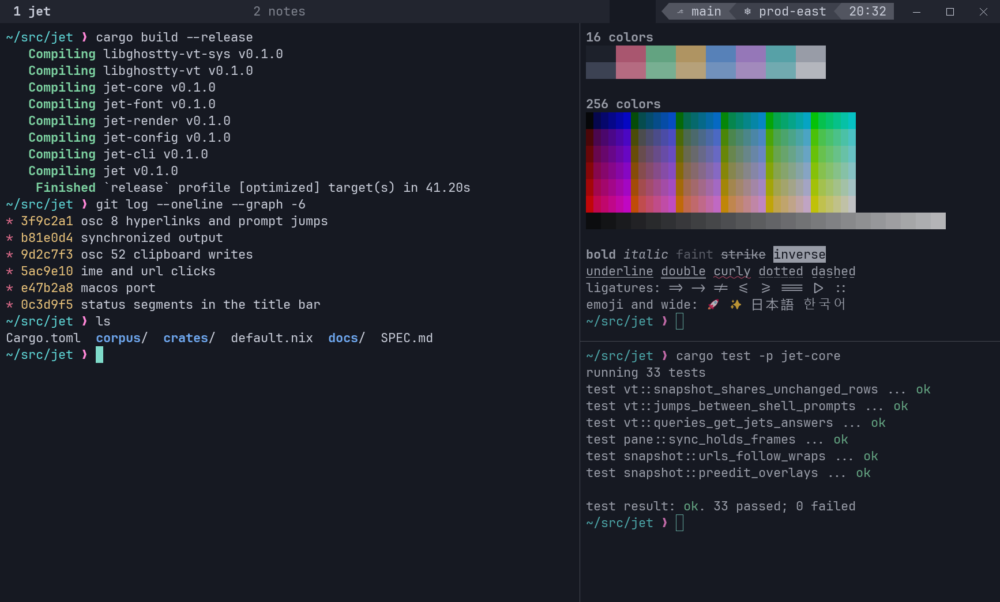

<p align="center"></p>

# jet

A fast, native terminal for Windows, macOS and Linux, and **jetmux**, a
multiplexer whose sessions jet shows as its own tabs and splits. Rust on
[libghostty-vt](https://ghostty.org): Ghostty's terminal emulation, with
jet's own renderer, windowing and app shell.




## jet

- **Ghostty's emulation:** parsing, scrollback, reflow, the Kitty keyboard
  protocol and mouse reporting come from libghostty-vt. Images with the
  Kitty graphics protocol.
- **GPU rendering** with wgpu (DirectX 12, Metal, Vulkan): ligatures, color
  emoji, fallback fonts. Ghostty's ~900 themes built in, previewed live from
  the palette, with a light and a dark one following the system.
- **Tabs, splits and profiles** (named shells, or `ssh` straight into a
  box), with zoom, resize and a **command palette** for every action. Right
  click the tab bar for a profile menu; separate default profiles for new
  windows, quake and new tabs. A profile can have its own theme and a tab
  color (the whole tab, an edge line, a dot or the title), and so can a
  host: ssh into `prod-*` and the pane turns red. Any tab can be colored
  from the palette.
- **Safe by default:** asks before closing a tab or window with something
  running, and before pasting lines a prompt would run (not into programs
  with bracketed paste).
- **Search** (text or regex) over screen and history, **copy mode** with vi
  keys, and **quick select** for URLs, paths and hashes.
- **Shell integration** for bash, zsh and PowerShell, set up without
  touching your dotfiles: directory reports (OSC 7), prompt marks (OSC 133)
  for jump-to-prompt, copying the last output and showing its exit status.
- **Status segments** in the title bar, tab bar or a row: `{user}@{host}`,
  `{dir}`/`{cwd}`, the running program, progress, git or k8s context from a
  script (`{var.NAME}`). They follow ssh and sudo. See
  [docs/status.md](docs/status.md).
- **Plumbing:** Ctrl+click text a regex matches (it underlines while Ctrl is
  held) to open a URL, run a program, or open a split on the box the pane
  is ssh'd into. `file:line` to your editor, hashes to `git show`.
- **Follow ssh:** a new tab from a pane running `ssh` (or `wsl.exe`) lands on
  the same host in the same directory.
- **Quake window:** a global hotkey (`ctrl+space`, `ctrl+grave` on macOS)
  drops a window from any edge or fraction of the screen. Drag it by the
  tab bar or size it from an edge and it comes back there for the session.
  On Windows it starts at sign-in by default, with its own profile and a
  tray icon, optionally over the taskbar, and works over games that turn
  hotkeys off (`hotkey-hook`). There can be several (`[quake.NAME]`, on
  Windows), each with its own place, profile and hotkeys: ones sharing a
  hotkey drop together, like a terminal on each side of the screen.
- **Session restore**, desktop **notifications** (OSC 9/777), taskbar
  **progress** (OSC 9;4), **clipboard writes** (OSC 52, never reads),
  hyperlinks (OSC 8).
- **Window styling:** jet's own title bar with the tabs in it, opacity, and
  on Windows Mica/Acrylic, corners and border colors.
- **`jet-cli`** drives running windows from scripts: open tabs and splits,
  send and read text, set titles and status variables, stream events.
- **Ghostty config passthrough:** an existing Ghostty config, its themes
  and `keybind` lines work as they are.

## jetmux

A tmux-style daemon that owns the shells, so sessions outlive any client.

- **Shown by jet as native tabs:** a profile with `jetmux = { host = ... }`
  runs `ssh host jetmux proxy` and turns the session's tabs and splits into
  jet's, drawn by jet in your theme. Closing a tab closes it on the host;
  `detach` (palette or a keybind) leaves the session running. Quitting jet
  leaves it running too.
- **A terminal client** (`jetmux attach`) for any other terminal, with a
  prefix key (`C-b`), a status bar sharing jet's segments, copy mode and a
  palette.
- **Survives restarts:** `jetmux upgrade` replaces the daemon without losing
  a process; `snapshot`/`restore` bring sessions back after a reboot, shells
  in their old directories with the last command typed but not run.
- **Profiles:** named layouts (tabs, splits, commands, env) that
  `jetmux up NAME` creates or attaches to.
- **Roaming:** `jetmux remote host` is a mosh-style UDP link that survives
  sleep and network changes, with predictive echo on slow links.
- **Scripting:** `jetmux pane send-keys/capture/wait`, command blocks, JSON
  events, and a socket API.
- **Companions:** `jetmux-web` (browser and phone client, via `tailscale
  serve`), `jetmux-notify` (desktop, webhook and web push alerts for app
  notifications and slow commands), `jetmux-mcp` (an MCP server for
  agents), `jetmux-rec` (asciicast recording and playback).
- **One config:** jetmux reads jet's `[jetmux]`, `[theme]`, `[colors]` and
  `[status]`, then its own `~/.config/jetmux/config.toml` on top. See
  [docs/jetmux.toml](docs/jetmux.toml).

## Install

|             |                                                                                                                                                                                                                                                                                                                                                  |
| ----------- | ------------------------------------------------------------------------------------------------------------------------------------------------------------------------------------------------------------------------------------------------------------------------------------------------------------------------------------------------ |
| **Windows** | The `.msi` (per-user, no admin: Start Menu, PATH, "Open jet here" in Explorer, upgrades in place), or Scoop: `scoop install https://github.com/jpetrucciani/jet/releases/latest/download/jet.json`, then `scoop update jet`. Or unzip anywhere, keeping `conpty.dll` and `OpenConsole.exe` beside `jet.exe` (a newer ConPTY than Windows ships). |
| **macOS**   | Move `jet.app` to Applications. Not notarized yet: allow it under Privacy & Security, or `xattr -dr com.apple.quarantine /Applications/jet.app`.                                                                                                                                                                                                 |
| **Linux**   | Put `jet` and `jet-cli` on `PATH`. Needs Vulkan (or GL) and Wayland or X11, glibc 2.35+.                                                                                                                                                                                                                                                         |
| **jetmux**  | Static binaries for any x86_64 or aarch64 Linux, and Apple silicon macOS: untar onto `PATH` on each server.                                                                                                                                                                                                                                      |
| **Nix**     | `import ./jet { }` gives `jetmux`, `jetmux-static` and `homeManagerModules.default` (`programs.jet`, `programs.jetmux`, with a systemd user service).                                                                                                                                                                                            |

jet's x86_64 builds need AVX2 (x86-64-v3: Intel Haswell, AMD Zen or newer).
jetmux's run on any x86_64 or aarch64.

## Configure

jet reads the first of `$JET_CONFIG`, `~/.jet/config.toml`, then
`%APPDATA%\jet\config.toml` (Windows) or `~/.config/jet/config.toml`.
Every key with its default is in [docs/config.toml](docs/config.toml).
Changes apply on save; `jet config check` shows what was read and what's
wrong. In the palette, **Open config** opens it (`$EDITOR` in a new tab, else
the system's editor), starting a missing one as that file commented out, and
**Choose theme** previews themes as you move and writes the one you pick.

`jet [DIR] [--profile NAME] [-e COMMAND ARGS...]` opens a window there or
running that; `jet quake [NAME]` toggles the drop-down window (or one of
them).

```toml
include = ["local.toml"] # per-machine overrides; fine if missing

[font]
family = "JetBrains Mono"
size = 13

[theme]
name = "Dracula+ High Contrast" # any Ghostty theme

[window]
decorations = "custom" # jet's title bar, tabs in it

[shell] # Windows default: pwsh, else powershell
command = ["C:/Program Files/Git/bin/bash.exe", "-l"]
# profile = "bash"                  # new tabs and splits; [window] profile
# and [quake] profile for first tabs

[profiles.voyager]
command = "ssh voyager"

[profiles.dev] # a jetmux session as jet tabs
jetmux = { host = "voyager", session = "main", up = "dev" }

[[status.segments]]
text = "{user}@{host}"
[[status.segments]]
text = "{dir}"

[quake]
x = 0.0
width = 0.3 # the left 30%, full height
height = 1.0

[plumb.code] # Ctrl+click file:line
match = '(?<file>[\w./-]+\.\w+):(?<line>\d+)'
run = ["code", "--goto", "{file}:{line}"]

[keybinds]
"ctrl+alt+v" = "new_tab:voyager"
"ctrl+alt+m" = "new_tab:dev"
"ctrl+enter" = 'text:\r'
```

Default keys (macOS uses Command chords instead; all in docs/config.toml):

| Keys                                               | Action                                  |
| -------------------------------------------------- | --------------------------------------- |
| `ctrl+shift+c` / `v`                               | copy / paste                            |
| `ctrl+t`, `ctrl+shift+w`                           | new tab, close split or tab             |
| `ctrl+tab`, `alt+1..9`                             | next tab, go to tab                     |
| `ctrl+shift+o` / `e`                               | split right / down                      |
| `ctrl+alt+arrows`, `ctrl+shift+alt+arrows`         | move between / resize splits            |
| `ctrl+shift+enter`                                 | zoom split                              |
| `ctrl+shift+f`, `ctrl+shift+x`, `ctrl+shift+space` | search, copy mode, quick select         |
| `ctrl+shift+p`                                     | command palette                         |
| `ctrl+shift+page_up` / `down`                      | previous / next prompt                  |
| `ctrl+=`, `ctrl+-`, `ctrl+0`                       | font size                               |
| `ctrl+shift+alt+d`                                 | detach the jetmux session in front      |
| right click the tab bar                            | new tab from a profile (`new_tab_menu`) |

## Build

Everything builds in the Nix dev shell (`nix-shell` or direnv), with pinned
Rust, Zig and libghostty. Windows binaries cross-compile from Linux.
`cargo run -p jet` and `cargo run -p jetmux` work natively.

| Command                              | Does                                                                                                                     |
| ------------------------------------ | ------------------------------------------------------------------------------------------------------------------------ |
| `check`                              | fmt, clippy, tests (CI on Linux and macOS)                                                                               |
| `check_win`                          | clippy the Windows build (CI)                                                                                            |
| `check_web`                          | web UI types match the Rust ones, typecheck, build (CI)                                                                  |
| `build_win`                          | cross-compile every binary for Windows                                                                                   |
| `bundle_mac`                         | `target/release/jet.app`, on a Mac                                                                                       |
| `jetmux_ts`, `jetmux_web_build`      | regenerate the web UI's types, build it                                                                                  |
| `dist_linux`, `dist_win`, `dist_mac` | jet release archives in `target/dist`, profile-guided (Windows: zip and MSI, signed when `JET_SIGN_TOKEN` is set)        |
| `update_themes --release TAG`        | refresh the built-in themes from an iTerm2-Color-Schemes release                                                         |
| `win_manifests`                      | Scoop's `jet.json` and winget's manifests for the release in `target/dist`                                               |
| `dist_jetmux`                        | jetmux's release tarballs: static x86_64 and aarch64 Linux, Apple silicon macOS                                          |
| `pgo`, `pgo_win_bundle`              | record the profiles the dist builds use (Windows: run the bundle's `run.cmd` there, copy `raw/` to `target/pgo/win-raw`) |

Releases: bumping `[workspace.package] version` on main builds every
archive and publishes `v<version>`, its notes from that version's section
of [CHANGELOG.md](CHANGELOG.md).

## License

[MIT](LICENSE)
