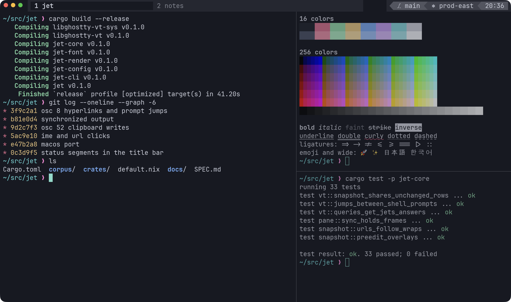

<p align="center"></p>

# jet

A fast, native terminal for Windows, macOS and Linux, written in Rust on
[libghostty-vt](https://ghostty.org): Ghostty's terminal emulation under a
renderer, window and app shell of its own.




## Features

- **Ghostty's emulation:** parsing, scrollback, reflow, the Kitty keyboard
  protocol and mouse reporting come from libghostty-vt.
- **GPU rendering** with wgpu (DirectX 12, Metal, Vulkan), ligatures, color
  emoji and fallback fonts for everything else.
- **Tabs and splits**, with profiles for different shells, opened from
  keybinds or the CLI. A split can zoom to fill its tab.
- **Search** through a pane's screen and history as you type
  (`ctrl+shift+f`, `cmd+f`), and a **command palette** (`ctrl+shift+p`,
  `cmd+shift+p`) for every action, profile and tab.
- **Window styling:** jet's own title bar with the tabs in it, background
  opacity, and on Windows Mica/Acrylic backdrops, corner and border styles.
- **Status segments** in the title bar, tab bar or a row of their own:
  `ssh` host, directory, running program, progress, or anything a script
  sets with OSC 1337 (`{var.k8s}`).
- **Quake mode:** `jet quake` drops a window down from a global hotkey on
  Windows and macOS. On Linux, bind `jet quake` in your desktop's shortcuts:
  running it again toggles the window (X11 or XWayland).
- **`jet-cli`** drives running windows from scripts: spawn tabs, split,
  send and read text, set titles and status variables, stream events.
- **Shell integration:** working directory reports (OSC 7, 9;9), prompt
  marks (OSC 133) with jump-to-prompt, copying the last command's output and
  its exit status in the status bar, hyperlinks (OSC 8) and URL clicks,
  clipboard writes (OSC 52), synchronized output, taskbar progress (OSC 9;4).
- **Images** with the Kitty graphics protocol.
- **Desktop notifications** programs ask for (OSC 9, OSC 777).
- **Ghostty config passthrough:** an existing Ghostty config, themes and
  keybinds work as-is.

## Install

Releases carry builds for Windows (x86_64), macOS (Apple Silicon) and
Linux (x86_64, glibc 2.35+). The x86_64 builds need a CPU with AVX2
(x86-64-v3: Intel Haswell or AMD Zen and newer).

- **Windows:** unzip anywhere and run `jet.exe`. Keep `conpty.dll` and
  `OpenConsole.exe` beside it; they're a newer ConPTY than Windows ships.
- **macOS:** unzip and move `jet.app` to Applications. It isn't notarized
  yet, so macOS blocks the first launch: allow it under System Settings,
  Privacy & Security, or run `xattr -dr com.apple.quarantine /Applications/jet.app`.
- **Linux:** untar and put `jet` and `jet-cli` on your `PATH`. Needs Vulkan
  (or GL) and Wayland or X11.

## Configure

`~/.jet/config.toml` (or `%APPDATA%\jet\config.toml`,
`~/.config/jet/config.toml`). Every key, with its default and allowed
values, is in [docs/config.toml](docs/config.toml). Changes apply on save;
`jet config check` shows what was read and what's wrong.

```toml
[font]
family = "JetBrains Mono"
size = 13

[theme]
name = "Poimandres"         # any Ghostty theme

[window]
decorations = "custom"      # jet's title bar, with the tabs in it

[keybinds]
"ctrl+shift+d" = "new_split:right"
```

Status segments: [docs/status.md](docs/status.md).

## Build

Everything builds from the Nix dev shell (`nix-shell`, or direnv), with
pinned Rust, Zig and libghostty. Windows binaries cross-compile from Linux.

| Command | Does |
| --- | --- |
| `check` | fmt, clippy and tests (what CI runs on Linux and macOS) |
| `build_win` / `check_win` | cross-compile for Windows / clippy the Windows code |
| `bundle_mac` | `target/release/jet.app`, on a Mac |
| `dist_linux`, `dist_win`, `dist_mac` | release archives in `target/dist`, profile-guided |
| `pgo` | record the PGO profile `dist_linux` and `dist_mac` build with |
| `pgo_win_bundle` | an instrumented Windows build to record `dist_win`'s profile with: run its `run.cmd` on Windows, copy `raw/` to `target/pgo/win-raw` |

`cargo run -p jet` runs it natively on Linux and macOS.

## License

[MIT](LICENSE)
